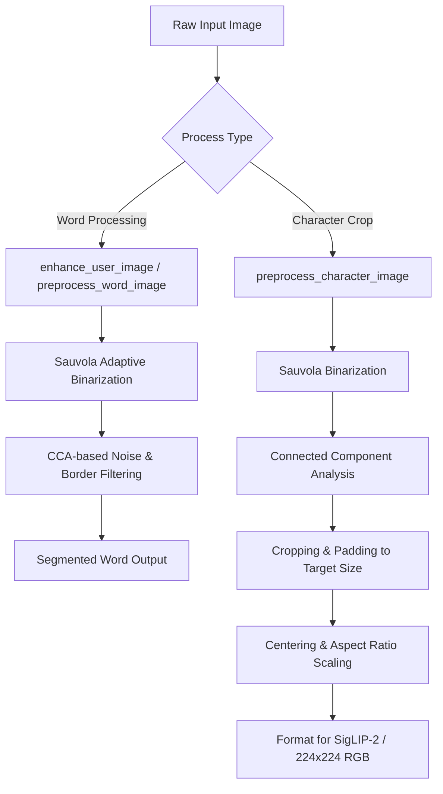

# HERA Preprocessing Pipeline: A Technical Deep Dive

In the Hybrid Error-Preserving Retrieval Architecture (HERA), preprocessing is a critical foundation. Because HERA relies on a retrieval-based paradigm (matching visual character crops against a vector database using fine-tuned **SigLIP-2** semantic embeddings and **HOG** structural descriptors), **preprocessing must be perfectly consistent across both database indexing and query inference.** Any inconsistency in binarization, scaling, or stroke thickness directly degrades similarity search in the vector space.

This document provides a detailed breakdown of the complete preprocessing workflow implemented in HERA, covering word-level preprocessing, character-level preprocessing, and shape-based geometric feature extraction.

---

## 🗺️ High-Level Preprocessing Architecture

HERA uses a two-level preprocessing strategy: **Word-level** and **Character-level**. Binarization is done **exactly once** at the word level, and that binary mask is inherited by all subsequent stages to prevent compounding thresholding errors.



---

## 1. ⚙️ Adaptive Binarization: The Sauvola Algorithm

Document images and classroom handwriting often suffer from uneven lighting, shadowing, ink bleeding, and low contrast. Standard global thresholding (like Otsu's method) fails in these scenarios. HERA uses **Sauvola Binarization** as its primary thresholding engine.

### Mathematical Formulation
For each pixel $(x, y)$, Sauvola computes a local threshold $T(x, y)$ within a sliding window (typically $25 \times 25$ pixels):

$$T(x, y) = m(x, y) \cdot \left[ 1 + k \cdot \left( \frac{s(x, y)}{R} - 1 \right) \right]$$

Where:
* $m(x, y)$ is the **local mean** intensity in the window.
* $s(x, y)$ is the **local standard deviation** in the window.
* $R$ is the **dynamic range** of the standard deviation (set to $128$ for 8-bit grayscale images).
* $k$ is a **control parameter** (set to $0.3$) that dictates how much of the threshold is adjusted based on local variance. High variance (near stroke edges) lowers the threshold, preserving delicate ligatures.

```python
# Sauvola Thresholding Implementation in preprocessing.py
img_float = gray.astype(float)
mean = cv2.blur(img_float, (window_size, window_size))
mean_sq = cv2.blur(img_float**2, (window_size, window_size))
std_dev = np.sqrt(np.maximum(mean_sq - mean**2, 0)) # Avoid negative sqrt

threshold = mean * (1 + k * ((std_dev / r) - 1))
binary = np.zeros_like(gray, dtype=np.uint8)
binary[img_float < threshold] = 255  # Text becomes white, background black
```

> [!NOTE]
> For high-contrast digital inputs (contrast > 180), the code performs a pre-emptive **morphological closing** (`MORPH_CLOSE`) before Sauvola to fill tiny interior gaps in pen strokes.

---

## 2. 🧹 Smart Cleaning via Connected Component Analysis (CCA)

Binarization often captures stray marks, page borders, underlines, or bleed-through from adjacent lines. HERA uses a robust heuristic filter using OpenCV’s 8-connectivity **Connected Component Analysis** (`cv2.connectedComponentsWithStats`) to isolate true Malayalam graphemes.

### 🌟 Character-Level Cleaning (`preprocess_character_image`)
When preprocessing a specific character crop for embedding generation:
1. **Compute Stats**: Finds the area, bounding box coordinates, and centroid of all white components.
2. **Noise Filter**: Discards components with an area smaller than $50\text{ px}^2$.
3. **Border Filter**: Discards components whose bounding box touches the outer edge of the crop, especially if their area exceeds 50% of the entire canvas (typically representing page borders or scanner frame lines).
4. **Distance Heuristic**: Calculates the Euclidean distance from each component's centroid to the canvas center:
   $$D = \sqrt{(c_x - \text{center}_x)^2 + (c_y - \text{center}_y)^2}$$
5. **Selection**: Keeps **only the single best component** (the largest, most centered non-border component) and suppresses all other pixels to pure background (0). This eliminates "bleed noise" from surrounding letters.

### 📝 Word-Level Cleaning (`preprocess_word_image`)
Unlike character crops, a word image contains multiple distinct components representing base letters, vowel diacritics, and anusvaras. 
1. **Dynamic Min Area**: Discards tiny noise below $\max(30, \text{Total Area} / 2000)$.
2. **Border Box Filter**: Detects and drops massive border structures (area > 60% of canvas) or components that touch all four edges.
3. **Underline Filter**: Discards elongated horizontal strokes:
   $$\text{Aspect Ratio} > 15 \quad \text{and} \quad \text{Height} < 10\text{ px}$$
4. **Relative Size Filter**: Calculates the **median area** of all valid components. Any component smaller than 10% of the median area is discarded. This preserves small dependent vowel signs (like the dot of the *anusvara*) while eliminating minor salt-and-pepper noise.

---

## 3. 🎯 Standardized Centering, Padding, and Resizing

Once the character is binarized and cleaned, it must be mapped to a standardized representation of **$224 \times 224$ pixels** to match the native vision transformer resolution of **SigLIP-2**.

| Step | Action | Purpose |
| :--- | :--- | :--- |
| **1. Bounding Box Crop** | Crop binary image tightly around the `cv2.findNonZero` coordinates with a small $2\text{ px}$ margin. | Removes outer blank space to maximize resolution of the actual character. |
| **2. Scale Estimation** | Scale factor: $S = \min\left(\frac{224}{W}, \frac{224}{H}\right) \cdot 0.85$ | Resizes the character to fit inside the target dimension while maintaining the **exact aspect ratio** and leaving a safe $15\%$ padding margin. |
| **3. Center & Paste** | Paste the resized character onto a pure white ($255$) canvas of size $224 \times 224$ at offsets:<br>$X_{\text{offset}} = \frac{224 - W_{\text{new}}}{2}$<br>$Y_{\text{offset}} = \frac{224 - H_{\text{new}}}{2}$ | Guarantees that the visual center of mass of the character aligns with the center of the image canvas. |
| **4. RGB Conversion**| Convert the final inverted single-channel canvas back to a three-channel RGB representation. | Necessary to match the expected multi-channel input format of the pretrained SigLIP-2 vision encoder. |

---

## 4. 🔗 Safe SigLIP Formatting: `format_for_siglip`

In HERA, there is a critical distinction between the generic preprocessing applied to raw images and `format_for_siglip`. 

> [!WARNING]
> Standard preprocessing uses morphological **dilation** (`cv2.dilate`) to thicken strokes and keep only the **largest** connected component. 
> 
> Doing this on pre-segmented characters is dangerous. For example, compound diacritics or multi-part vowel signs (like `െ` and `ാ` around a letter) are represented by separate disjoint components. Running standard character preprocessing on them would wipe out the smaller components.

`format_for_siglip` solves this by:
* Operating on an **already binarized and segmented** character image.
* Finding the bounding box of **all ink combined** rather than picking a single largest component.
* Safeguarding disjoint components (maintaining their spatial relative coordinates).
* Not applying artificial dilation, preserving the delicate, organic stroke widths of the writer's handwriting.

---

## 5. 📐 Geometric & Structural Shape Descriptors

To supplement the visual-semantic embeddings of SigLIP-2, HERA's hybrid retrieval system incorporates classical geometric and structural descriptors. These descriptors are calculated in parallel during preprocessing and concatenated with the semantic vectors.

```
Hybrid Vector (2,532-d) = [ 0.8 * SigLIP-2 (768-d)  |  0.2 * HOG (1,764-d) ]
```

`preprocessing.py` implements three sets of shape descriptors:

### A. Hu Moments (7-dimensional)
Hu Moments are central moments that are **invariant to scale, rotation, and translation**. They capture the global shape distribution of the character:
* Extracted from the largest contour.
* Log-transformed for numerical stability:
  $$\text{Hu}_{\text{log}} = -\text{sign}(\eta_i) \cdot \log_{10}(|\eta_i|)$$

### B. Contour Descriptors
These represent geometric ratios derived from contours and convex hulls:
* **Circularity**: $\frac{4\pi \cdot \text{Area}}{\text{Perimeter}^2}$ (Measures how close the glyph is to a circle).
* **Solidity**: $\frac{\text{Area}}{\text{Convex Hull Area}}$ (Detects cavities or structural loops in complex conjuncts).
* **Extent**: $\frac{\text{Area}}{\text{Bounding Box Area}}$ (Measures visual density).
* **Aspect Ratio**: $\frac{\text{Width}}{\text{Height}}$ (Distinguishes wide conjuncts from tall, narrow vowel signs).
* **Compactness** & **Convexity**.

### C. Skeleton & Stroke Descriptors
Calculated by thinning the character to a single-pixel skeleton:
* **Stroke Length**: Sum of skeleton pixels.
* **Endpoints**: Calculated by convolving the skeleton with a $3 \times 3$ neighbor-counting kernel (endpoints have exactly $1$ neighbor besides themselves).
* **Junctions**: Skeleton pixels with $\ge 3$ active neighbors (where two strokes cross).
* **Average Stroke Width**: Extracted by computing a L2 Euclidean **Distance Transform** on the binary image and averaging the distance values along the skeleton line.

---

## 🚀 Performance Optimization: Parallel Threading

Preprocessing hundreds of thousands of character images for database indexing is highly CPU-bound. `preprocessing.py` implements `preprocess_images_batch` which utilizes a `ThreadPoolExecutor` with a dynamic thread count:

$$\text{Workers} = \min(32, \text{CPU Count} \times 4)$$

This bypasses the I/O bottleneck when streaming images from disk. Combined with HERA's GPU-pipelining embedder, this preprocessing pipeline achieves over **$500\text{ samples/second}$** throughput on modern hardware.
